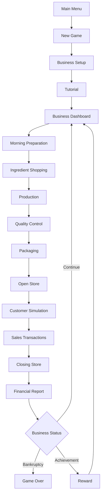
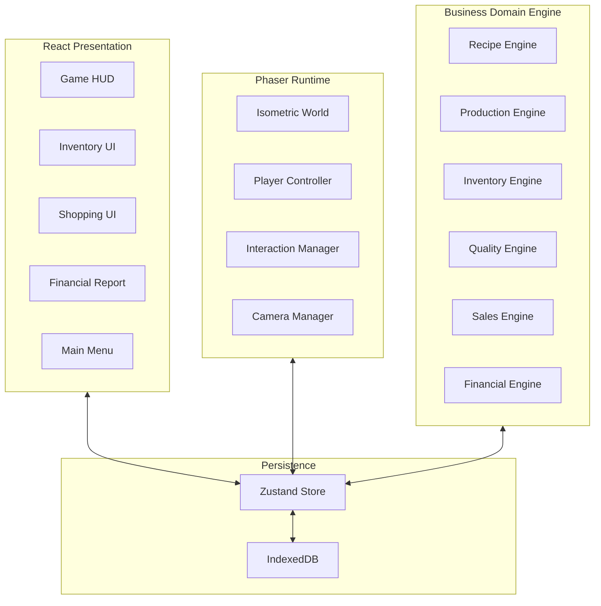
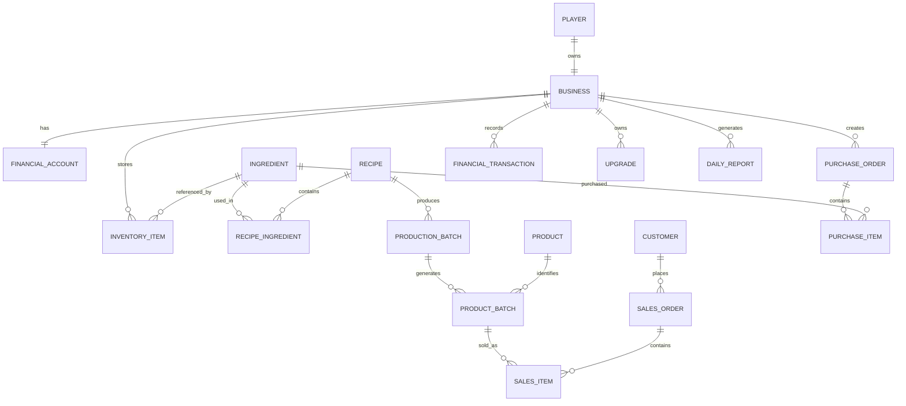

# DIMSUMPRENEUR
## Game Design Document (GDD) Teknis
### Healthy Dimsum Business Simulator

**Versi:** 1.0  
**Platform:** Web Browser  
**Genre:** Isometric Tycoon + Cooking Simulation + Business Management  
**Target pengguna:** General  
**Gameplay focus:** Balanced (produksi dan pengelolaan bisnis)  
**Teknologi target:** React, TypeScript, Phaser 3, Zustand, IndexedDB

---

# 1. Ringkasan Game

## 1.1 Konsep

Dimsumpreneur adalah game simulasi bisnis kuliner berbasis web. Pemain membangun dan mengelola usaha dimsum sehat dari tahap persiapan bahan, pengembangan resep, produksi, pemeriksaan kualitas, pengemasan, hingga penjualan kepada pelanggan.

Game menggunakan perspektif **2D isometric** dengan nuansa visual cozy, hangat, ramah, dan mudah dipahami. Pemain mengendalikan karakter entrepreneur di dalam lingkungan dapur dan outlet, berinteraksi dengan workstation, mengelola persediaan, serta mengambil keputusan bisnis.

## 1.2 Tujuan Game

- Memberikan pengalaman membangun dan menjalankan bisnis dimsum sehat.
- Mengajarkan alur produksi makanan dari bahan baku hingga produk siap jual.
- Memperkenalkan konsep resep, kualitas produk, persediaan, dan pengemasan.
- Memperkenalkan perhitungan HPP, harga jual, pendapatan, biaya, dan laba.
- Mengembangkan kemampuan mengambil keputusan melalui simulasi pasar dan pelanggan.

## 1.3 Target Pengguna

Game ditujukan untuk pengguna umum, termasuk pemain kasual dan pengguna yang tertarik pada simulasi kuliner atau kewirausahaan. Tingkat kesulitan awal dibuat ramah pemula, dengan kompleksitas bisnis yang meningkat secara bertahap.

## 1.4 Core Gameplay Loop

1. Persiapkan usaha dan periksa kondisi bisnis.
2. Beli bahan baku dari pasar atau supplier.
3. Pilih resep dan tentukan jumlah produksi.
4. Lakukan persiapan, pencampuran, pembentukan, dan pengukusan.
5. Periksa kualitas produk.
6. Kemas produk yang lolos pemeriksaan.
7. Buka outlet dan layani pelanggan.
8. Catat transaksi dan evaluasi laporan keuangan.
9. Gunakan keuntungan untuk membeli bahan, mengembangkan produk, dan meningkatkan fasilitas.
10. Lanjutkan ke hari bisnis berikutnya.

## 1.5 Design Pillars

| Pilar | Prinsip Desain |
|---|---|
| Accessible Simulation | Mudah dipahami tanpa pengalaman bisnis sebelumnya |
| Meaningful Decisions | Keputusan produksi dan harga berdampak pada bisnis |
| Balanced Gameplay | Aktivitas memasak dan pengelolaan usaha sama penting |
| Clear Feedback | Pemain memahami alasan keberhasilan atau kegagalan |
| Cozy Isometric World | Dunia visual menarik dan nyaman dijelajahi |
| Reliable Economy | Seluruh transaksi dan perhitungan dapat ditelusuri |

---

# 2. Game Design Overview

## 2.1 Genre dan Perspektif

- Genre: Business Simulation, Cooking Simulation, Tycoon.
- Perspektif: 2D isometric.
- Mode: Single-player.
- Platform: Web browser.
- Orientasi: Desktop-first, responsive untuk tablet dan mobile.
- Sesi permainan: Berbasis hari bisnis.

## 2.2 Fokus Balanced

Gameplay membagi perhatian pemain antara dua kelompok aktivitas:

**Produksi**
- Memilih resep.
- Mengelola komposisi bahan.
- Menjalankan mini-game memasak.
- Memastikan kualitas dan keamanan proses simulasi.
- Mengemas produk.

**Bisnis**
- Membeli bahan dan mengelola stok.
- Menentukan harga jual.
- Melayani pelanggan.
- Mengelola arus kas dan biaya.
- Mengembangkan fasilitas dan reputasi.

Tidak ada satu kelompok aktivitas yang boleh menjadi satu-satunya penentu keberhasilan.

## 2.3 Starting Capital

Modal awal: **Rp500.000**.

| Alokasi | Anggaran |
|---|---:|
| Bahan baku awal | Rp150.000 |
| Peralatan dasar | Rp200.000 |
| Packaging | Rp50.000 |
| Cadangan kas | Rp100.000 |
| **Total** | **Rp500.000** |

Nilai ini merupakan parameter simulasi awal dan dapat disesuaikan pada proses balancing.

---

# 3. World Design dan Isometric Environment

## 3.1 Area Game World

Lingkungan awal berupa satu outlet dimsum dengan area:

1. Main Kitchen.
2. Ingredient Storage.
3. Preparation Table.
4. Mixing Station.
5. Steamer Station.
6. Packaging Station.
7. Cashier.
8. Customer Area.
9. Upgrade Area.

## 3.2 Isometric Coordinate System

Rekomendasi konfigurasi awal:

- Tile width: 64 px.
- Tile height: 32 px.
- Rasio proyeksi: 2:1.
- Depth sorting berdasarkan koordinat dunia.
- Collision berbasis grid dan area objek.

Utilitas yang diperlukan:

```typescript
worldToScreen(x: number, y: number)
screenToWorld(x: number, y: number)
calculateDepth(x: number, y: number)
findNearestInteractable(position: Position)
```

## 3.3 Player Movement

Karakter dapat bergerak menggunakan:

- W/A/S/D.
- Arrow keys.
- Virtual joystick untuk perangkat sentuh.

Kontrol interaksi:

- E: Interaksi.
- Space: Konfirmasi.
- ESC: Pause.

Animasi minimum:

- Idle.
- Walk NE.
- Walk NW.
- Walk SE.
- Walk SW.
- Interact.
- Carry.
- Celebrate.

Karakter tidak boleh menembus dinding, furniture, atau objek yang diblokir.

## 3.4 Interactive Objects

Objek interaktif memberikan indikator ketika pemain berada dalam jarak interaksi.

Contoh:

- Ingredient Storage: membuka inventory.
- Market Terminal: membuka pasar.
- Preparation Table: memulai persiapan bahan.
- Mixing Station: membuka mini-game mixing.
- Steamer: membuka mini-game steaming.
- Packaging Station: membuka proses pengemasan.
- Cashier: membuka transaksi.
- Business Board: membuka laporan bisnis.

---

# 4. Gameplay Mechanics

## 4.1 Ingredient Shopping

Pemain membeli bahan baku melalui pasar virtual atau supplier.

Setiap bahan mempunyai atribut:

| Atribut | Deskripsi |
|---|---|
| Ingredient ID | Identitas bahan |
| Name | Nama bahan |
| Category | Protein, vegetable, seasoning, wrapper |
| Unit | Gram, pcs, ml, kg, pack |
| Purchase Price | Harga pembelian |
| Stock | Jumlah tersedia |
| Expiry Day | Masa simpan |
| Quality | Kualitas bahan |
| Supplier | Sumber pembelian |

Aturan inventory:

1. Pembelian mengurangi saldo kas.
2. Stok bertambah setelah transaksi berhasil.
3. Produksi mengurangi stok sesuai resep.
4. Bahan kedaluwarsa tidak dapat digunakan.
5. Pengeluaran stok bahan mengikuti FEFO.
6. Pemain mendapat peringatan jika stok tidak mencukupi.
7. Transaksi pembelian harus tercatat satu kali.

Bahan awal:

- Ayam.
- Udang.
- Tahu.
- Wortel.
- Bayam.
- Brokoli.
- Jamur.
- Bawang putih.
- Bumbu.
- Kulit dimsum.
- Tepung tapioka.

## 4.2 Recipe and Product Mechanics

Sistem resep mendukung:

- Resep standar.
- Resep vegetarian.
- Resep kombinasi protein dan sayuran.
- Custom recipe.
- Recipe unlock.
- Recipe quality rating.

### Contoh Resep: Chicken Carrot Dimsum

| Parameter | Nilai |
|---|---:|
| Batch size | 10 pcs |
| Production time | 60 detik simulasi |
| Base difficulty | Easy |
| Base quality | 75 |
| Shelf life | 2 hari simulasi |

| Bahan | Jumlah per 10 pcs |
|---|---:|
| Ayam | 100 gram |
| Wortel | 50 gram |
| Kulit dimsum | 10 pcs |
| Bawang putih | 6 gram |
| Tepung tapioka | 20 gram |
| Bumbu | 4 gram |

Angka resep merupakan data game, bukan panduan produksi pangan komersial.

## 4.3 Cooking Mini-Games

Proses produksi dibagi menjadi empat mini-game.

### A. Preparation

Pemain memilih bahan dan melakukan persiapan melalui drag-and-drop.

Penilaian:
- Memilih bahan yang benar.
- Memasukkan bahan ke area persiapan.
- Menyelesaikan seluruh kebutuhan resep.

### B. Mixing

Pemain mengatur komposisi bahan.

Penilaian berdasarkan kesesuaian formula dengan resep.

### C. Wrapping

Pemain membentuk dimsum melalui interaksi mouse atau touchscreen.

Penilaian:
- Ketepatan posisi.
- Konsistensi bentuk.
- Jumlah produk yang berhasil dibentuk.

### D. Steaming

Pemain mengatur proses pengukusan simulasi.

Parameter:
- Durasi.
- Suhu simulasi.
- Konsistensi proses.

MVP tidak membutuhkan simulasi termodinamika kompleks. Gunakan rentang parameter resep yang telah ditentukan.

## 4.4 Cooking Quality Formula

Nilai kualitas akhir:

\[
Q = 0.25R + 0.20M + 0.20W + 0.20S + 0.15H
\]

Keterangan:

- R: Recipe Accuracy.
- M: Mixing Quality.
- W: Wrapping Quality.
- S: Steaming Quality.
- H: Hygiene Compliance.

Semua nilai berada pada rentang 0–100.

| Skor | Kategori |
|---|---|
| 90–100 | Excellent |
| 80–89 | Very Good |
| 70–79 | Good |
| 60–69 | Average |
| 0–59 | Poor |

Kualitas produk memengaruhi kepuasan pelanggan, reputasi, dan penerimaan harga jual dalam simulasi.

## 4.5 Quality Control

Parameter pemeriksaan:

1. Kesesuaian bentuk.
2. Kualitas bahan.
3. Kesesuaian resep.
4. Kebersihan proses.
5. Kematangan simulasi.

Status produk:

| Status | Makna |
|---|---|
| Draft | Belum selesai diproduksi |
| Processing | Sedang diproduksi |
| QC Passed | Lolos pemeriksaan |
| QC Failed | Gagal pemeriksaan |
| Packaged | Sudah dikemas |
| Sold | Terjual |
| Expired | Kedaluwarsa |

Produk yang gagal QC tidak boleh dijual sebagai produk lolos QC.

## 4.6 Packaging Mechanics

Pilihan kemasan awal:

| Kemasan | Kapasitas | Biaya |
|---|---:|---:|
| Paper Box | 4 pcs | Rp500 |
| Standard Box | 8 pcs | Rp800 |
| Family Box | 16 pcs | Rp1.500 |

Setiap kemasan memiliki harga, kapasitas, tipe, tampilan, dan label brand.

Produk harus lolos QC sebelum dikemas.

## 4.7 Customer Simulation

Pelanggan muncul berdasarkan waktu permainan dan reputasi bisnis.

Arketipe pelanggan:

| Tipe | Budget | Prioritas |
|---|---|---|
| Student | Rendah | Harga |
| Worker | Menengah | Kecepatan |
| Family | Tinggi | Paket |
| Food Explorer | Menengah | Variasi |
| Healthy Food Enthusiast | Menengah | Komposisi |

Atribut pelanggan:

```text
Customer
├── Customer ID
├── Customer Type
├── Budget
├── Preferred Product
├── Patience
├── Purchase Probability
└── Satisfaction
```

Siklus pelanggan:

```text
SPAWN
  -> ENTER SHOP
  -> BROWSE MENU
  -> SELECT PRODUCT
  -> CHECK AVAILABILITY
  -> PLACE ORDER
  -> PAYMENT
  -> WAIT FOR ORDER
  -> RECEIVE PRODUCT
  -> RATE EXPERIENCE
  -> EXIT SHOP
```

Jika produk tidak tersedia, pelanggan dapat meninggalkan outlet. Perilaku ini harus memperbarui statistik layanan dan kepuasan.

### Customer Satisfaction

\[
CS = 0.35Q + 0.25P + 0.20T + 0.20V
\]

- Q: Product Quality.
- P: Price Satisfaction.
- T: Service Time.
- V: Product Availability.

Formula merupakan parameter awal yang perlu diuji melalui playtesting.

## 4.8 Sales Mechanics

Dua jenis penjualan:

**Direct Sales**
- Pelanggan datang ke outlet.
- Memilih produk.
- Melakukan pembayaran.
- Menerima produk.

**Pre-Order Sales**
- Pelanggan memesan produk.
- Pesanan masuk ke antrean produksi atau stok.
- Pemain memenuhi pesanan sesuai kapasitas.

Data transaksi:
- Transaction ID.
- Customer ID.
- Product.
- Quantity.
- Unit Price.
- Discount.
- Total.
- Payment Status.
- Transaction Time.

## 4.9 Upgrade Mechanics

| Upgrade | Level 1 | Level 2 | Level 3 |
|---|---|---|---|
| Steamer | 10 pcs | 20 pcs | 40 pcs |
| Refrigerator | 50 kg | 100 kg | 200 kg |
| Preparation Table | 1 station | 2 stations | 3 stations |
| Packaging Station | 1 station | 2 stations | 3 stations |
| Shop Decoration | Basic | Standard | Premium |

Kapasitas merupakan parameter desain awal, bukan spesifikasi peralatan nyata.

---

# 5. Business Economy System

## 5.1 Economy Design

Mata uang game menggunakan Rupiah virtual.

Sistem ekonomi harus menyeimbangkan:
- Modal.
- Biaya bahan baku.
- Biaya produksi.
- Biaya kemasan.
- Harga jual.
- Pendapatan.
- Biaya operasional.
- Persediaan.
- Laba dan arus kas.

## 5.2 Financial Calculation Engine

### Total Production Cost

\[
TPC = C_i + C_p + C_o + C_l
\]

- Ci: Ingredient Cost.
- Cp: Packaging Cost.
- Co: Operational Cost.
- Cl: Labor Cost.

### HPP

\[
HPP = \frac{TPC}{Q_p}
\]

Qp adalah jumlah produk yang berhasil diproduksi.

### Selling Price

\[
SP = HPP \times (1 + M)
\]

M adalah target markup.

Contoh markup 50% dengan HPP Rp1.500:

\[
SP = 1.500 \times 1.5 = Rp2.250
\]

### Revenue

\[
Revenue = \sum_{i=1}^{n}(Price_i \times Quantity_i) - Discount
\]

### Gross Profit

\[
GrossProfit = Revenue - COGS
\]

### Net Profit

\[
NetProfit = Revenue - COGS - OPEX
\]

### Cash Balance

\[
Cash_{end} = Cash_{start} + CashIn - CashOut
\]

Aturan:
- HPP penjualan dihitung berdasarkan biaya produk yang terjual.
- Produk yang belum terjual tetap dicatat sebagai inventory.
- Produk kedaluwarsa dicatat sebagai kerugian persediaan.
- Pendapatan tidak sama dengan laba.
- Arus kas tidak sama dengan laba akuntansi.

## 5.3 Inventory Valuation

Gunakan dua aturan dengan tujuan berbeda:

- **FIFO:** menentukan biaya persediaan yang dikeluarkan untuk penilaian biaya.
- **FEFO:** memprioritaskan bahan dengan tanggal kedaluwarsa terdekat untuk pengeluaran stok.

Keduanya harus diimplementasikan secara terpisah.

## 5.4 Dynamic Market System

Harga bahan dapat berubah berdasarkan hari permainan.

Contoh harga normal:

| Bahan | Harga Normal |
|---|---:|
| Ayam | Rp45.000/kg |
| Wortel | Rp15.000/kg |
| Udang | Rp70.000/kg |
| Kulit dimsum | Rp20.000/pack |
| Jamur | Rp25.000/kg |

Event pasar dapat mengubah harga dalam rentang simulasi. Perubahan harus ditampilkan sebelum pemain melakukan pembelian.

## 5.5 Business Performance Dashboard

Dashboard menampilkan:
- Revenue harian.
- Total pengeluaran.
- HPP.
- Gross profit.
- Net profit.
- Total produk diproduksi.
- Total produk terjual.
- Produk kedaluwarsa.
- Customer rating.
- Business reputation.

Laporan tersedia dalam tampilan harian dan riwayat beberapa hari.

---

# 6. Game Flow and State Management

## 6.1 Main Game Flow



## 6.2 Game State Definition

| State | Deskripsi |
|---|---|
| MAIN_MENU | Menu utama |
| BUSINESS_SETUP | Membuat bisnis |
| TUTORIAL | Tutorial gameplay |
| MORNING_PREP | Persiapan usaha |
| SHOPPING | Belanja bahan |
| PRODUCTION | Produksi |
| QUALITY_CONTROL | Pemeriksaan |
| PACKAGING | Pengemasan |
| STORE_OPEN | Outlet dibuka |
| CUSTOMER_SERVICE | Pelayanan pelanggan |
| STORE_CLOSING | Penutupan |
| FINANCIAL_REPORT | Laporan keuangan |
| GAME_PAUSED | Permainan dihentikan sementara |
| GAME_OVER | Bisnis mengalami kegagalan |

State dikelola menggunakan satu sumber kebenaran (*single source of truth*). Perpindahan state harus divalidasi agar tidak terjadi kondisi yang tidak sah.

## 6.3 Save and Load

Data yang disimpan:
- Business profile.
- Player position.
- Inventory.
- Recipes unlocked.
- Production batches.
- Product inventory.
- Cash balance.
- Transactions.
- Upgrades.
- Current day.
- Achievements.
- Game settings.

MVP menggunakan IndexedDB. Autosave dilakukan pada transaksi penting dan pergantian fase hari.

Gunakan versi save data dan migration handler agar perubahan struktur tidak merusak progres lama.

---

# 7. Technical Architecture

## 7.1 Recommended Technology Stack

| Komponen | Teknologi | Tanggung Jawab |
|---|---|---|
| Game Engine | Phaser 3 | Isometric world, character, camera, animation |
| Frontend | React | UI dan dashboard |
| Language | TypeScript | Type safety |
| Build Tool | Vite | Development dan build |
| Styling | Tailwind CSS | UI styling |
| State Management | Zustand | Shared state |
| Persistence | IndexedDB | Save game |
| Testing | Vitest | Unit dan integration test |
| E2E Testing | Playwright | End-to-end test |
| Future Backend | FastAPI | REST API |
| Future Database | PostgreSQL | Cloud persistence |

**Keputusan arsitektur:** Phaser menangani game world dan interaksi karakter. React menangani antarmuka bisnis. Perhitungan ekonomi berada di domain engine TypeScript yang tidak bergantung pada Phaser atau React.

## 7.2 Application Architecture



## 7.3 Recommended Project Structure

```text
dimsumpreneur/
├── public/
│   ├── assets/
│   │   ├── characters/
│   │   ├── environment/
│   │   ├── furniture/
│   │   ├── ingredients/
│   │   ├── food/
│   │   ├── ui/
│   │   ├── icons/
│   │   └── audio/
│   └── data/
│       ├── ingredients.json
│       ├── recipes.json
│       ├── products.json
│       ├── customers.json
│       └── upgrades.json
├── src/
│   ├── app/
│   ├── game/
│   │   ├── config/
│   │   ├── scenes/
│   │   ├── entities/
│   │   ├── systems/
│   │   ├── maps/
│   │   └── utils/
│   ├── features/
│   │   ├── business/
│   │   ├── inventory/
│   │   ├── shopping/
│   │   ├── production/
│   │   ├── recipe/
│   │   ├── packaging/
│   │   ├── sales/
│   │   ├── customer/
│   │   ├── finance/
│   │   └── upgrades/
│   ├── domain/
│   │   ├── entities/
│   │   ├── engines/
│   │   ├── calculations/
│   │   ├── rules/
│   │   └── events/
│   ├── components/
│   ├── store/
│   ├── persistence/
│   ├── data/
│   ├── hooks/
│   ├── types/
│   └── utils/
├── tests/
│   ├── unit/
│   ├── integration/
│   └── e2e/
├── docs/
│   ├── GDD.md
│   ├── ARCHITECTURE.md
│   └── GAME_BALANCING.md
├── package.json
├── tsconfig.json
└── vite.config.ts
```

---

# 8. Domain Engine and Event Contract

## 8.1 Domain Engines

| Engine | Tanggung Jawab |
|---|---|
| InventoryEngine | Stok dan masa simpan |
| RecipeEngine | Formula resep |
| ProductionEngine | Proses produksi |
| QualityEngine | Skor kualitas |
| PackagingEngine | Pengemasan |
| CustomerEngine | Perilaku pelanggan |
| SalesEngine | Pesanan dan transaksi |
| FinanceEngine | HPP dan laporan |
| UpgradeEngine | Pengembangan fasilitas |
| ProgressionEngine | Level dan achievement |

## 8.2 Domain Events

```typescript
type GameEvent =
  | { type: "INGREDIENT_PURCHASED"; payload: PurchaseData }
  | { type: "PRODUCTION_STARTED"; payload: ProductionData }
  | { type: "PRODUCTION_COMPLETED"; payload: ProductionResult }
  | { type: "QUALITY_CHECKED"; payload: QualityResult }
  | { type: "PRODUCT_PACKAGED"; payload: PackagingData }
  | { type: "ORDER_CREATED"; payload: OrderData }
  | { type: "ORDER_COMPLETED"; payload: OrderResult }
  | { type: "DAY_CLOSED"; payload: DailyReport };
```

Event memperbarui UI, histori transaksi, achievement, dan autosave.

## 8.3 Example: HPP Function

```typescript
interface ProductionCost {
  ingredientCost: number;
  packagingCost: number;
  operationalCost: number;
  laborCost: number;
}

interface HPPResult {
  totalCost: number;
  quantity: number;
  unitCost: number;
}

export function calculateHPP(
  cost: ProductionCost,
  quantity: number
): HPPResult {
  if (quantity <= 0) {
    throw new Error("Production quantity must be positive");
  }

  const totalCost =
    cost.ingredientCost +
    cost.packagingCost +
    cost.operationalCost +
    cost.laborCost;

  return {
    totalCost,
    quantity,
    unitCost: totalCost / quantity,
  };
}
```

Untuk implementasi mata uang, gunakan integer Rupiah atau representasi decimal yang aman. Fungsi domain sebaiknya murni (*pure functions*) agar dapat diuji dengan input yang sama.

## 8.4 Example: Sales Calculation

```typescript
interface SalesInput {
  quantity: number;
  unitPrice: number;
  discount: number;
}

export function calculateSales(input: SalesInput) {
  if (input.quantity <= 0 || input.unitPrice < 0) {
    throw new Error("Invalid sales input");
  }

  const subtotal = input.quantity * input.unitPrice;

  if (input.discount < 0 || input.discount > subtotal) {
    throw new Error("Invalid discount");
  }

  return {
    subtotal,
    discount: input.discount,
    total: subtotal - input.discount,
  };
}
```

## 8.5 Future REST API

Base path: `/api/v1`

| Method | Endpoint | Fungsi |
|---|---|---|
| POST | /games | Membuat game baru |
| GET | /games/{id} | Mengambil progres |
| PUT | /games/{id}/save | Menyimpan progres |
| GET | /ingredients | Daftar bahan |
| GET | /recipes | Daftar resep |
| POST | /production | Memulai produksi |
| POST | /production/{id}/qc | Quality control |
| POST | /purchases | Pembelian bahan |
| POST | /sales | Membuat transaksi |
| GET | /finance/report | Laporan keuangan |
| GET | /business/stats | Statistik bisnis |
| POST | /business/upgrades | Upgrade fasilitas |

Backend belum wajib untuk MVP. API masa depan harus memvalidasi input, otorisasi pemilik game, dan menggunakan transaksi database untuk operasi keuangan.

---

# 9. Data Model and Database Design

## 9.1 Data Architecture

MVP menggunakan IndexedDB. Model domain dirancang agar dapat dipetakan ke PostgreSQL ketika backend ditambahkan.

Kelompok data:
1. Master Data: resep, bahan, produk, harga, upgrade.
2. Transactional Data: pembelian, produksi, penjualan, inventory, dan laporan.

## 9.2 Entity Relationship Diagram



## 9.3 Master Data Schema

### ingredients

| Field | Type | Description |
|---|---|---|
| id | UUID | Primary key |
| name | VARCHAR(100) | Nama bahan |
| category | VARCHAR(50) | Kategori |
| unit | VARCHAR(20) | Satuan |
| base_price | DECIMAL(14,2) | Harga dasar |
| shelf_life_days | INT | Masa simpan |
| is_active | BOOLEAN | Status |

### recipes

| Field | Type | Description |
|---|---|---|
| id | UUID | Primary key |
| name | VARCHAR(100) | Nama resep |
| description | TEXT | Deskripsi |
| batch_size | INT | Jumlah produksi |
| base_quality | DECIMAL(5,2) | Kualitas dasar |
| production_time | INT | Durasi simulasi |
| difficulty | VARCHAR(20) | Kesulitan |
| is_unlocked | BOOLEAN | Status unlock |

### recipe_ingredients

| Field | Type | Description |
|---|---|---|
| id | UUID | Primary key |
| recipe_id | UUID | FK recipes |
| ingredient_id | UUID | FK ingredients |
| quantity | DECIMAL(12,3) | Kebutuhan |
| unit | VARCHAR(20) | Satuan |

### products

| Field | Type | Description |
|---|---|---|
| id | UUID | Primary key |
| name | VARCHAR(100) | Nama produk |
| recipe_id | UUID | FK recipes |
| selling_price | DECIMAL(14,2) | Harga jual |
| description | TEXT | Deskripsi |
| is_active | BOOLEAN | Status |

## 9.4 Transactional Data Schema

### businesses

| Field | Type | Description |
|---|---|---|
| id | UUID | Primary key |
| player_id | UUID | Pemilik |
| name | VARCHAR(100) | Nama bisnis |
| level | INT | Level usaha |
| reputation | DECIMAL(5,2) | Reputasi |
| current_day | INT | Hari permainan |
| created_at | TIMESTAMP | Waktu pembuatan |

### inventory_items

| Field | Type | Description |
|---|---|---|
| id | UUID | Primary key |
| business_id | UUID | FK business |
| ingredient_id | UUID | FK ingredient |
| quantity | DECIMAL(12,3) | Jumlah stok |
| unit_cost | DECIMAL(14,2) | Biaya per unit |
| purchased_at_day | INT | Hari pembelian |
| expiry_day | INT | Hari kedaluwarsa |

### production_batches

| Field | Type | Description |
|---|---|---|
| id | UUID | Primary key |
| business_id | UUID | FK business |
| recipe_id | UUID | FK recipe |
| quantity | INT | Jumlah produksi |
| quality_score | DECIMAL(5,2) | Skor kualitas |
| status | VARCHAR(30) | Status produksi |
| production_day | INT | Hari produksi |
| total_cost | DECIMAL(14,2) | Biaya batch |

### product_batches

| Field | Type | Description |
|---|---|---|
| id | UUID | Primary key |
| production_batch_id | UUID | FK production batch |
| product_id | UUID | FK product |
| quantity_produced | INT | Produk dihasilkan |
| quantity_available | INT | Stok siap jual |
| unit_cost | DECIMAL(14,2) | HPP per unit |
| expiry_day | INT | Kedaluwarsa |

### customers

| Field | Type | Description |
|---|---|---|
| id | UUID | Primary key |
| customer_type | VARCHAR(50) | Tipe pelanggan |
| budget | DECIMAL(14,2) | Budget |
| patience | INT | Kesabaran |
| preference | JSON | Preferensi produk |

### sales_orders

| Field | Type | Description |
|---|---|---|
| id | UUID | Primary key |
| business_id | UUID | FK business |
| customer_id | UUID | FK customer |
| total_amount | DECIMAL(14,2) | Total transaksi |
| discount | DECIMAL(14,2) | Diskon |
| status | VARCHAR(30) | Status |
| day | INT | Hari transaksi |

### sales_items

| Field | Type | Description |
|---|---|---|
| id | UUID | Primary key |
| sales_order_id | UUID | FK order |
| product_batch_id | UUID | FK product batch |
| quantity | INT | Jumlah terjual |
| unit_price | DECIMAL(14,2) | Harga jual |
| unit_cost | DECIMAL(14,2) | Biaya per unit |

### financial_transactions

| Field | Type | Description |
|---|---|---|
| id | UUID | Primary key |
| business_id | UUID | FK business |
| transaction_type | VARCHAR(30) | INCOME / EXPENSE |
| category | VARCHAR(50) | Kategori |
| amount | DECIMAL(14,2) | Nominal |
| reference_id | UUID | Referensi transaksi |
| day | INT | Hari transaksi |
| created_at | TIMESTAMP | Waktu |

## 9.5 Data Integrity Rules

- Setiap bisnis memiliki satu akun keuangan.
- Saldo kas tidak boleh negatif.
- Pembelian harus memiliki saldo yang mencukupi.
- Produksi harus memiliki bahan yang mencukupi.
- Produk tidak dapat dijual sebelum lolos QC.
- Produk kedaluwarsa tidak dapat dijual.
- Penjualan tidak boleh melebihi stok tersedia.
- Transaksi finansial harus memiliki referensi sumber.
- Satu transaksi tidak boleh diproses dua kali.
- Penghapusan master data tidak boleh merusak histori transaksi.

---

# 10. UI/UX Design

## 10.1 Visual Direction

Art direction: Cozy Isometric.

| Elemen | Rekomendasi |
|---|---|
| Art Style | Cozy Isometric |
| Rendering | 2D Isometric |
| Mood | Friendly, Warm, Relaxing |
| Primary Color | Sage Green |
| Secondary Color | Cream |
| Accent | Orange |
| Background | Warm Beige |
| Typography | Rounded Sans Serif |
| Icon Style | Rounded Illustration |

### Color Palette

| Nama | Hex |
|---|---|
| Forest Green | #244D3B |
| Sage Green | #6E9B72 |
| Mint | #D9E8C8 |
| Cream | #F6EBD4 |
| Orange | #ED9B53 |
| White | #FFFFFF |

## 10.2 Main Game Layout

Area antarmuka:

| Komponen | Posisi | Fungsi |
|---|---|---|
| Top HUD | Atas | Saldo, hari, reputasi |
| Game World | Tengah | Lingkungan isometric |
| Interaction Panel | Bawah | Instruksi interaksi |
| Quick Access | Kanan | Inventory dan menu |
| Notification | Atas kanan | Event dan informasi |

HUD menampilkan:
- Current Day.
- Cash Balance.
- Business Level.
- Reputation.
- Store Status.
- Active Mission.

## 10.3 Screen Inventory

1. Main Menu: New Game, Continue, Settings, Credits.
2. Business Setup: nama bisnis dan konsep usaha.
3. Main Gameplay: isometric map, player, objek interaktif, HUD.
4. Ingredient Market: stok, supplier, harga, shopping cart.
5. Inventory: bahan dan produk.
6. Recipe Book: daftar resep dan detail formula.
7. Production Interface: mini-game memasak.
8. Quality Control: pemeriksaan dan skor.
9. Packaging: pilihan kemasan.
10. Cashier: pesanan dan pembayaran.
11. Financial Dashboard: HPP, revenue, profit, biaya.
12. Upgrade Interface: peningkatan fasilitas.
13. Pause Menu.
14. Game Over.

## 10.4 Interaction Design Principles

- Aktivitas utama dapat diakses maksimal tiga langkah interaksi.
- Informasi uang dan stok selalu terlihat.
- Objek interaktif memiliki visual feedback.
- Tombol memiliki state normal, hover, active, dan disabled.
- Aktivitas produksi memiliki progress indicator.
- Transaksi memiliki konfirmasi sebelum saldo berubah.
- Kesalahan dijelaskan dengan bahasa sederhana.
- UI mendukung desktop dan mobile.
- Gunakan modal atau side panel kontekstual agar game world tidak tertutup panel permanen.

---

# 11. Non-Functional Requirements

## 11.1 Performance

| ID | Requirement | Target |
|---|---|---|
| NFR-01 | Initial loading | Target di bawah 5 detik pada lingkungan uji yang ditetapkan |
| NFR-02 | Gameplay rendering | Target 60 FPS pada perangkat referensi |
| NFR-03 | UI response | Di bawah 200 ms untuk interaksi lokal sederhana |
| NFR-04 | Save operation | Di bawah 1 detik untuk save normal |
| NFR-05 | Asset loading | Lazy loading bila diperlukan |

Target tersebut harus diverifikasi melalui pengujian, bukan dianggap sebagai performa yang sudah tercapai.

## 11.2 Compatibility

- Chrome.
- Edge.
- Firefox.
- Safari yang mendukung teknologi aplikasi.
- Desktop dan laptop.
- Tablet.
- Mobile browser.

## 11.3 Reliability

- Autosave.
- Validasi save data.
- Recovery setelah halaman di-refresh.
- Pencegahan transaksi ganda.
- Error handling asset loading.
- Fallback jika audio tidak tersedia.
- Pencegahan saldo dan stok negatif.

## 11.4 Security

- Validasi seluruh input.
- Hindari penyimpanan credential.
- Hindari penggunaan `eval`.
- Sanitasi data pengguna sebelum ditampilkan sebagai HTML.
- Validasi versi save game.
- Batasi fitur developer/debug pada production build.

## 11.5 Accessibility

- Kontras warna memadai.
- Ikon disertai label.
- Font mudah dibaca.
- Kontrol keyboard.
- Alternatif visual untuk informasi audio.
- Ukuran tombol sesuai penggunaan touchscreen.

---

# 12. Testing and Acceptance Criteria

## 12.1 Testing Strategy

| Jenis | Pengujian |
|---|---|
| Unit Test | HPP, sales, inventory |
| Integration Test | Production ke inventory |
| Integration Test | Sales ke finance |
| Game Test | Movement dan interaction |
| UI Test | Modal, dashboard, form |
| E2E Test | Satu siklus bisnis |
| Persistence Test | Save dan load |
| Performance Test | FPS dan loading |
| Responsive Test | Desktop dan mobile |

## 12.2 Acceptance Criteria

| ID | Kriteria |
|---|---|
| AC-01 | Pemain dapat memulai bisnis baru |
| AC-02 | Pemain dapat bergerak di lingkungan isometric |
| AC-03 | Pemain dapat berinteraksi dengan workstation |
| AC-04 | Pemain dapat membeli bahan |
| AC-05 | Stok bertambah setelah pembelian |
| AC-06 | Pemain dapat membuat dimsum berdasarkan resep |
| AC-07 | Produksi mengurangi stok bahan secara tepat |
| AC-08 | Produk memperoleh skor kualitas |
| AC-09 | Produk harus lolos QC sebelum dijual |
| AC-10 | Produk dapat dikemas |
| AC-11 | Pelanggan dapat membeli produk |
| AC-12 | Penjualan memperbarui saldo |
| AC-13 | HPP dihitung berdasarkan biaya aktual |
| AC-14 | Laporan keuangan konsisten |
| AC-15 | Progres dapat disimpan dan dimuat kembali |

## 12.3 End-to-End Scenario: First Day Business

1. Pemain membuat bisnis baru.
2. Pemain memperoleh modal Rp500.000.
3. Pemain membeli bahan untuk 10 pcs dimsum.
4. Sistem mengurangi saldo dan menambahkan stok.
5. Pemain memilih resep Chicken Carrot Dimsum.
6. Pemain menyelesaikan mini-game produksi.
7. Sistem menghitung kualitas produk.
8. Pemain melakukan QC.
9. Pemain mengemas produk.
10. Pemain membuka outlet.
11. Pelanggan membeli produk.
12. Sistem mencatat pendapatan.
13. Pemain menutup outlet.
14. Sistem menampilkan laporan keuangan.
15. Pemain menyimpan progres.

**Acceptance Goal:** Satu siklus bisnis dapat diselesaikan tanpa kesalahan transaksi, stok negatif, atau inkonsistensi laporan.

---

# 13. Development Roadmap

## 13.1 Development Phases

| Sprint | Estimasi | Deliverable |
|---|---:|---|
| Sprint 1 | 1 minggu | Project setup, isometric world |
| Sprint 2 | 1 minggu | Character, camera, interaction |
| Sprint 3 | 1 minggu | Inventory, shopping |
| Sprint 4 | 1 minggu | Recipe, production |
| Sprint 5 | 1 minggu | Cooking mini-game, QC |
| Sprint 6 | 1 minggu | Packaging, customer |
| Sprint 7 | 1 minggu | Sales, financial engine |
| Sprint 8 | 1 minggu | Save system, testing, polish |

Estimasi awal untuk tim kecil dengan aset tersedia. Durasi aktual bergantung pada kompleksitas visual, kesiapan aset, dan kapasitas tim.

## 13.2 Milestones

**M1 — Playable Environment**
- Karakter bergerak.
- Kamera bekerja.
- Objek dapat diinteraksikan.

**M2 — Functional Production**
- Pemain dapat membeli bahan.
- Pemain dapat memproduksi dimsum.

**M3 — Business Simulation**
- Penjualan, pelanggan, HPP, dan keuangan berfungsi.

**M4 — Complete Gameplay Loop**
- Aktivitas bisnis terintegrasi dari awal sampai akhir hari.

**M5 — Release Candidate**
- Save system, testing, responsive UI, audio, dan dokumentasi selesai.

---

# 14. Implementation Backlog

| ID | Task | Priority | Dependency |
|---|---|---|---|
| DEV-001 | Project initialization | Critical | - |
| DEV-002 | Isometric coordinate system | Critical | DEV-001 |
| DEV-003 | Isometric map | Critical | DEV-002 |
| DEV-004 | Player movement | Critical | DEV-003 |
| DEV-005 | Camera and collision | High | DEV-004 |
| DEV-006 | Interaction system | Critical | DEV-005 |
| DEV-007 | Inventory engine | Critical | DEV-001 |
| DEV-008 | Ingredient market | Critical | DEV-007 |
| DEV-009 | Recipe engine | Critical | DEV-007 |
| DEV-010 | Cooking mini-games | Critical | DEV-009 |
| DEV-011 | Quality control | Critical | DEV-010 |
| DEV-012 | Packaging system | High | DEV-011 |
| DEV-013 | Customer simulation | High | DEV-006 |
| DEV-014 | Sales engine | Critical | DEV-012 |
| DEV-015 | Financial engine | Critical | DEV-014 |
| DEV-016 | Daily report | High | DEV-015 |
| DEV-017 | Save/load | Critical | DEV-001 |
| DEV-018 | Automated tests | Critical | Core modules |

## 14.1 MVP Completion Gates

1. **Playable Isometric World:** karakter, kamera, collision, interaksi.
2. **Functional Cooking:** belanja, resep, produksi, QC.
3. **Business Operations:** packaging, customer, sales.
4. **Financial Simulation:** HPP, laba, stok, laporan.
5. **Playable Release:** save game, testing, build, dokumentasi.

---

# 15. Key Architecture Decisions and Risks

| Keputusan | Rekomendasi | Alasan |
|---|---|---|
| Game engine | Phaser 3 | Cocok untuk isometric 2D browser game |
| Frontend | React | UI dan dashboard modular |
| Programming | TypeScript | Konsistensi tipe data |
| Game state | Zustand | Shared state |
| Persistence | IndexedDB | Save game lokal |
| Backend | Ditunda | Belum dibutuhkan MVP |
| Economy engine | Pure TypeScript | Akurasi dan testability |
| Visual | Isometric 2D | Sesuai konsep tycoon |
| Gameplay | Balanced | Produksi dan bisnis sama penting |

Risiko teknis tertinggi:
1. Isometric depth sorting dan collision.
2. Sinkronisasi state React dengan Phaser.
3. Konsistensi inventory dan transaksi keuangan.
4. Kompleksitas mini-game produksi.
5. Keseimbangan ekonomi.

Rekomendasi: bangun satu area isometric yang benar-benar dapat dimainkan terlebih dahulu. Setelah itu hubungkan objek interaktif ke sistem produksi dan bisnis. Hindari memulai dari dashboard yang belum terhubung dengan gameplay.

---

# 16. Master Prompt for Coding Agent

Prompt berikut dapat digunakan pada Claude Code, Codex, Cursor, atau coding agent lain.

## MASTER DEVELOPMENT PROMPT

### 16.1 Role

Act as a Senior Game Developer, Game Systems Designer, Full-Stack Engineer, UI/UX Designer, and Software Architect.

Develop a complete browser-based isometric business simulation game named:

**DIMSUMPRENEUR — Healthy Dimsum Business Simulator**

You are responsible for designing, implementing, testing, and documenting a playable game.

Do not create a static prototype, dashboard-only application, or landing page.

The final product must have an interactive game world, playable character, functioning cooking activities, inventory management, customer simulation, sales transactions, financial calculations, and persistent game progression.

### 16.2 Project Objectives

Build a cozy isometric food business simulation in which players establish and operate a healthy dimsum business.

Players must be able to:

1. Create their own dimsum business.
2. Move around an isometric restaurant.
3. Purchase ingredients.
4. Manage ingredient inventory.
5. Select and customize recipes.
6. Prepare and produce dimsum.
7. Complete cooking mini-games.
8. Evaluate product quality.
9. Package finished products.
10. Open the store.
11. Serve customers.
12. Process sales.
13. Calculate HPP and profit.
14. Upgrade business equipment.
15. Save and continue their progress.

Target audience: General players.  
Platform: Web browser, desktop-first with responsive mobile support.  
Game genre: Isometric Tycoon + Cooking Simulation + Business Management.

### 16.3 Technology Stack

Use:

- React.
- TypeScript.
- Vite.
- Phaser 3.
- Zustand.
- Tailwind CSS.
- IndexedDB.
- Vitest.
- Playwright.

Architecture requirements:

- React manages UI and menus.
- Phaser manages game world, character, camera, animation, and object interaction.
- TypeScript domain modules manage business calculations and game rules.
- Zustand manages shared application and game state.
- IndexedDB manages persistent local save data.

Keep the game engine independent from the business calculation engine.

Do not implement financial rules directly inside React components or Phaser scenes.

Do not introduce a backend for the initial MVP. Prepare interfaces for future FastAPI and PostgreSQL integration.

### 16.4 Visual Design

Create a cozy, friendly, stylized isometric environment.

Visual direction:
- Isometric 2D environment.
- Warm lighting.
- Soft shadows.
- Rounded objects.
- Friendly cartoon characters.
- Detailed kitchen environment.
- Attractive food illustrations.

Color palette:
- Forest Green: #244D3B.
- Sage Green: #6E9B72.
- Mint: #D9E8C8.
- Cream: #F6EBD4.
- Orange: #ED9B53.
- White: #FFFFFF.

Use consistent visual assets throughout the game. Create original assets or use properly licensed assets. If final art assets are unavailable, create consistent temporary vector or illustrated assets. Do not leave the world as empty colored rectangles or generic placeholder geometry.

### 16.5 Game World

Create one interactive restaurant environment with:

1. Main Kitchen.
2. Ingredient Storage.
3. Preparation Table.
4. Mixing Station.
5. Steamer Station.
6. Packaging Station.
7. Cashier.
8. Customer Area.
9. Upgrade Area.

Use an isometric tile system:
- Tile width: 64 px.
- Tile height: 32 px.
- Isometric projection: 2:1.
- Depth sorting based on world coordinates.
- Grid-based collision.

Implement reusable utilities:
- worldToScreen().
- screenToWorld().
- calculateDepth().
- findNearestInteractable().

The camera must follow the player smoothly. The player must not walk through walls, furniture, or blocked objects.

### 16.6 Player System

Create one playable entrepreneur character.

Required animations:
- Idle.
- Walk NE.
- Walk NW.
- Walk SE.
- Walk SW.
- Interact.
- Carry.
- Celebrate.

Desktop controls:
- W/A/S/D: Movement.
- Arrow keys: Movement.
- E: Interaction.
- Space: Confirm.
- ESC: Pause.

Mobile controls:
- Virtual joystick.
- Interaction button.
- Responsive game viewport.

The interaction system must detect nearby objects and display contextual instructions.

### 16.7 Game State

Implement a centralized state machine.

Required states:
- MAIN_MENU.
- BUSINESS_SETUP.
- TUTORIAL.
- MORNING_PREP.
- SHOPPING.
- PRODUCTION.
- QUALITY_CONTROL.
- PACKAGING.
- STORE_OPEN.
- CUSTOMER_SERVICE.
- STORE_CLOSING.
- FINANCIAL_REPORT.
- GAME_PAUSED.
- GAME_OVER.

Prevent invalid state transitions. For example:
- The player cannot open the store if no products are available.
- The player cannot start production when ingredients are insufficient.
- The player cannot sell products that have not passed QC.

### 16.8 Gameplay Modules

**A. Business Startup**
- Initial capital: Rp500,000.
- Allow business name, business concept, and target market selection.
- Record all financial transactions.
- Use the initial allocation defined in this GDD.

**B. Ingredient Market**
- Implement ingredient catalog, prices, cart, quantity adjustment, purchase validation, receipt, and inventory update.
- Ingredient properties: ID, name, category, unit, price, quantity, shelf life, quality.
- Initial ingredients: chicken, shrimp, tofu, carrot, spinach, broccoli, mushroom, garlic, seasoning, dumpling wrapper, tapioca flour.
- Do not allow negative inventory or purchases exceeding available cash.
- Implement FEFO inventory consumption and FIFO inventory cost valuation.

**C. Recipe Management**
Initial recipes:
1. Chicken Carrot Dimsum.
2. Shrimp Vegetable Dimsum.
3. Tofu Mushroom Dimsum.
4. Rainbow Veggie Dimsum.

Each recipe contains ingredients, required quantities, batch size, production duration, difficulty, base quality, shelf life, product image, and unlock status.

Show missing ingredients before production starts.

**D. Cooking Simulation**

Implement four interactive mini-games:

Preparation:
- Select ingredients.
- Drag ingredients into preparation area.
- Complete ingredient checklist.

Mixing:
- Combine ingredients.
- Match recipe composition.
- Evaluate mixing accuracy.

Wrapping:
- Use mouse or touch input.
- Perform drag-and-drop wrapping.
- Evaluate shape consistency.

Steaming:
- Start steamer.
- Control simulated cooking duration.
- Display progress.
- Evaluate cooking quality.

All mini-games must produce actual gameplay outcomes. Do not replace cooking simulation with a static confirmation button.

**E. Quality Control**

Calculate:

Q = 0.25R + 0.20M + 0.20W + 0.20S + 0.15H

Where:
- R = Recipe Accuracy.
- M = Mixing Quality.
- W = Wrapping Quality.
- S = Steaming Quality.
- H = Hygiene Compliance.

Quality range: 0–100.

Categories:
- 90–100: Excellent.
- 80–89: Very Good.
- 70–79: Good.
- 60–69: Average.
- Below 60: Poor.

Show a visual quality report. Only products passing the configured QC threshold can be packaged for sale.

**F. Packaging**
- Paper Box: 4 pcs.
- Standard Box: 8 pcs.
- Family Box: 16 pcs.

Each package has name, capacity, cost, remaining stock, and visual design. Allow package selection and quantity selection. Calculate packaging cost and deduct package inventory.

**G. Customer Simulation**

Customer types:
- Student.
- Office Worker.
- Family.
- Food Explorer.
- Healthy Food Enthusiast.

Customer attributes:
- Budget.
- Product preference.
- Patience.
- Purchase probability.
- Satisfaction.

Lifecycle:

SPAWN -> ENTER -> BROWSE -> SELECT PRODUCT -> PLACE ORDER -> PAY -> WAIT -> RECEIVE PRODUCT -> RATE -> EXIT.

Implement customer spawning, queue management, product selection, stock validation, purchase decisions, waiting time, and satisfaction calculation.

Customers must interact with the store environment, not just appear as dashboard statistics.

**H. Sales System**

Implement:
- Product list.
- Prices.
- Quantity selection.
- Sales processing.
- Discounts.
- Payment confirmation.
- Receipts.

All transactions must update cash balance, product inventory, sales history, financial reports, and business reputation.

Prevent duplicate transactions.

**I. Financial Management**

Implement a deterministic financial calculation engine.

Required calculations:
1. Total Production Cost.
2. HPP per unit.
3. Selling Price.
4. Revenue.
5. COGS.
6. Gross Profit.
7. Operating Expenses.
8. Net Profit.
9. Cash Balance.
10. Inventory Valuation.

Rules:
- Separate revenue from profit.
- Separate cash flow from accounting profit.
- Unsold products remain in inventory.
- Sold product costs are recognized as COGS.
- Expired products are recorded as inventory loss.
- Never calculate profit by simply adding revenue to cash balance.
- Use integer Rupiah or a safe decimal representation.
- Every transaction must be recorded exactly once.

**J. Daily Business Report**

Display:
- Starting cash.
- Total purchases.
- Production quantity.
- Sold quantity.
- Unsold quantity.
- Expired quantity.
- Total revenue.
- Total COGS.
- Gross profit.
- Operating expenses.
- Net profit.
- Ending cash.
- Customer satisfaction.

Include charts for daily business performance.

**K. Business Upgrades**

Implement:
- Steamer capacity.
- Refrigerator capacity.
- Preparation stations.
- Packaging stations.
- Shop decoration.

Every upgrade must have a purchase price, levels, actual gameplay effect, updated statistics, and persistent save data.

### 16.9 Economy Balancing

Create:

`src/config/gameBalance.ts`

Centralize:
- Initial capital.
- Ingredient prices.
- Recipe formulas.
- Packaging costs.
- Product prices.
- Customer behavior parameters.
- Quality thresholds.
- Upgrade costs.
- Event probabilities.
- Production times.

Do not scatter economy constants throughout components.

All economy calculations must be deterministic. Random events may affect market conditions or customer behavior, but financial calculation rules must remain deterministic.

### 16.10 UI/UX

Create:
1. Main Menu.
2. Business Setup.
3. Tutorial.
4. Main Gameplay.
5. Ingredient Market.
6. Inventory.
7. Recipe Book.
8. Production Interface.
9. Quality Control.
10. Packaging.
11. Cashier.
12. Financial Dashboard.
13. Upgrade Interface.
14. Pause Menu.
15. Game Over.

Gameplay HUD:
- Current Day.
- Cash Balance.
- Business Level.
- Reputation.
- Store Status.
- Active Mission.

Use a consistent design system, readable typography, responsive layout, visual feedback, loading indicators, and accessible buttons.

Do not overcrowd the game world with permanent panels. Use contextual modals and side panels.

### 16.11 Save System

Implement IndexedDB persistence.

Save:
- Player profile.
- Business profile.
- Player position.
- Current day.
- Cash balance.
- Inventory.
- Recipes.
- Production batches.
- Product inventory.
- Transactions.
- Upgrades.
- Achievements.
- Game settings.

Implement:
- New Game.
- Save Game.
- Auto Save.
- Load Game.
- Continue Game.
- Reset Game.

Use versioned save data. Prevent corrupted save files from crashing the application.

### 16.12 Testing Requirements

Implement automated tests for:
- HPP calculation.
- Selling price.
- Revenue.
- COGS.
- Gross profit.
- Net profit.
- Cash balance.
- Inventory consumption.
- FEFO selection.
- FIFO cost valuation.
- Production validation.
- QC scoring.
- Packaging validation.
- Sales transactions.
- Save and load.

End-to-end test:

New Game -> Purchase Ingredients -> Select Recipe -> Produce Dimsum -> QC -> Packaging -> Open Store -> Customer Purchase -> Financial Report -> Save Game -> Reload Game.

Verify cash, inventory, sales history, and financial reports remain consistent.

### 16.13 Development Workflow

**Phase 1 — Foundation**
- Inspect repository.
- Initialize or adapt project.
- Configure React, Vite, TypeScript, and Phaser.
- Create architecture.
- Implement isometric coordinate system.

**Phase 2 — Playable World**
- Create kitchen environment.
- Implement player movement.
- Implement camera.
- Implement collision.
- Implement object interactions.

**Phase 3 — Business System**
- Implement inventory.
- Implement market.
- Implement recipe system.
- Implement production engine.
- Implement cooking mini-games.
- Implement quality control.

**Phase 4 — Sales System**
- Implement packaging.
- Implement customers.
- Implement cashier.
- Implement transactions.
- Implement financial engine.

**Phase 5 — Game Progression**
- Implement daily cycle.
- Implement achievements.
- Implement upgrades.
- Implement business progression.

**Phase 6 — Polish and Testing**
- Implement save system.
- Improve visual assets.
- Add animations and audio.
- Implement responsive UI.
- Run tests.
- Run production build.
- Fix identified issues.

Develop in small, independently testable modules. At the end of each phase, verify that the application builds and existing functionality remains operational.

### 16.14 Acceptance Criteria

The game is MVP-complete only when:
1. Main menu works.
2. A new business can be created.
3. Player can move around the isometric environment.
4. Interactive objects work.
5. Ingredients can be purchased.
6. Inventory updates correctly.
7. Recipes can be selected.
8. Cooking mini-games are playable.
9. Production quality is calculated.
10. QC is functional.
11. Products can be packaged.
12. Customers can enter and purchase products.
13. Sales transactions work.
14. HPP and profit are calculated correctly.
15. Financial reports are consistent.
16. Game can be saved and reloaded.
17. Complete daily gameplay loop works.
18. No critical runtime errors remain.
19. Production build succeeds.
20. Core automated tests pass.

### 16.15 Implementation Rules

- Do not create only a visual mockup.
- Do not use fake financial calculations.
- Do not hardcode dashboard statistics disconnected from game state.
- Do not use buttons without functional behavior.
- Do not leave core modules as TODO placeholders.
- Do not use random values for financial calculations.
- Do not allow negative inventory or cash.
- Do not allow invalid sales.
- Do not duplicate financial transactions.
- Do not break the save system when adding features.
- Do not introduce unnecessary backend complexity.
- Do not claim a feature is complete without testing it.

If an asset is missing, create a consistent temporary asset and document its replacement requirement.

If requirements conflict, preserve business rules and document the conflict before implementation.

### 16.16 Final Deliverables

Provide:
1. Complete source code.
2. Functional browser-based game.
3. Complete isometric game environment.
4. Functional business simulation engine.
5. Functional cooking mini-games.
6. Inventory and recipe systems.
7. Customer and sales systems.
8. Financial calculation engine.
9. Persistent save system.
10. Automated tests.
11. README.md.
12. GDD.md.
13. ARCHITECTURE.md.
14. GAME_BALANCING.md.

README must include project overview, technology stack, installation, development commands, production build, testing instructions, game controls, and gameplay instructions.

### 16.17 Final Execution Instruction

Start by inspecting the current repository.

If an existing application is available, preserve compatible architecture and existing work.

Create an implementation backlog and execute it phase by phase.

Do not stop after generating a project plan.

Proceed with actual implementation, testing, debugging, and verification.

The final objective is a fully playable MVP of:

**DIMSUMPRENEUR — HEALTHY DIMSUM BUSINESS SIMULATOR.**

At completion, provide:
- Implemented features.
- Project folder structure.
- Important source files.
- Installation instructions.
- Commands executed.
- Build results.
- Test results.
- Known limitations.
- Recommended next development phase.

---

# 17. Final Implementation Recommendation

Jangan memulai dari dashboard atau sistem keuangan saja. Bangun satu area isometric yang benar-benar dapat dimainkan, kemudian hubungkan objek interaktif ke sistem produksi dan bisnis.

Urutan prioritas:
1. Playable isometric world.
2. Functional cooking.
3. Business operations.
4. Financial simulation.
5. Save system, testing, dan release.

Dengan urutan tersebut, Dimsumpreneur dikembangkan sebagai game simulasi yang utuh, bukan aplikasi manajemen bisnis yang hanya dibungkus tampilan game.
